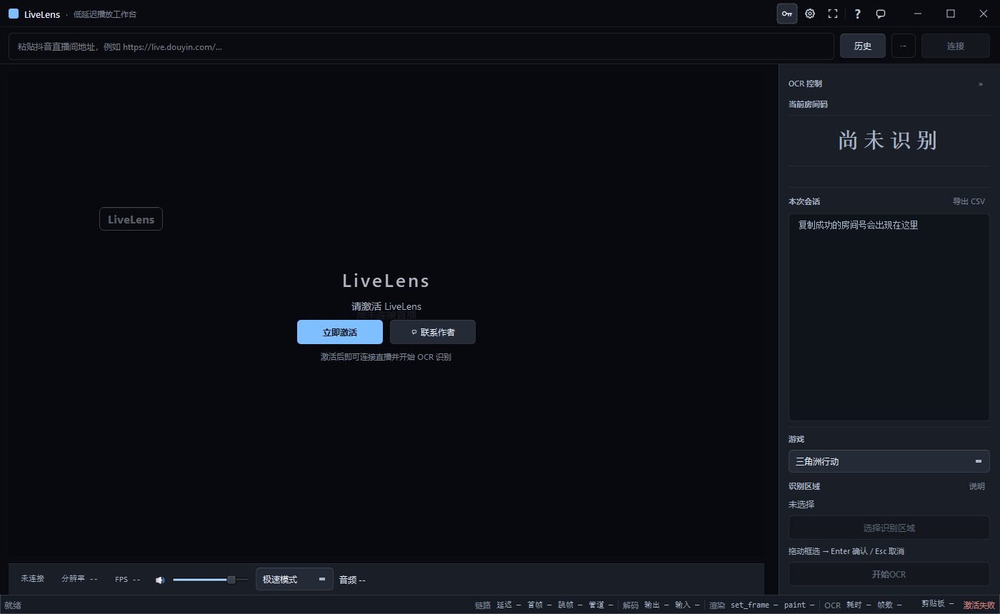

# LiveLens — 直播间低延迟观看 · 房间码 OCR · 一键自动加入

LiveLens(原 Douyin Low Latency Viewer)是一款面向 Windows 的直播低延迟播放工作台:把直播画面以**尽可能小的延迟**呈现出来,从画面中 **OCR 识别自定义房间码**,并支持**一键自动加入**游戏房间(当前支持无畏契约国服自定义房)。内置完整的**授权体系**(激活码 / 设备绑定 / 管理后台 / 自动更新),面向商业分发。

```
直播流 ──► FFmpeg 解码 ──► 最新帧渲染(丢旧不攒延迟)
                │
                └──► ROI 裁剪 ──► OCR 识别 ──► 严格校验 ──► 剪贴板
                                                        │
                              全局热键 F8 ──► 自动切换游戏窗口 ──► 点粘贴 ──► 点加入
```

## 目录

1. [功能特性](#功能特性)
1. [新电脑复现(clone 即用)](#新电脑复现clone-即用)
2. [界面预览](#界面预览)
3. [目录结构](#目录结构)
4. [环境要求](#环境要求)
5. [源码运行](#源码运行)
6. [测试](#测试)
7. [性能基准](#性能)
8. [打包发布](#打包发布)
9. [授权系统](#授权系统license_server)
10. [风险与合规声明](#风险与合规声明)
11. [版本沿革](#版本沿革)
12. [License](#license)

## 功能特性

### 播放
- **低延迟优先**:最新帧架构(latest-frame),积压帧直接丢弃,解码到显示全链路毫秒级观测
- **多平台解析**:抖音直播(含关注页直播间)、虎牙、B 站(平台适配器架构,新增平台只需实现 `stream/adapters/base.py` 接口)
- **裸流直取**(抖音):从页面直接获取 FLV 裸流,实测画面领先旧链路约 0.7 秒;FFmpeg 7 运行时自动管理,故障自动回退
- **候选流自动切换**(failover):一个流地址起不来自动试下一个,断流自愈,看门狗
- **音频**:独立音频服务,极速模式(最新声音优先)/同步模式(连贯优先),零缓冲直出;音量支持拖动/滚轮/点击图标静音

### OCR(房间码识别)
- **游戏感知**:按游戏档配置房间码格式(三角洲行动 / 三角洲 1v1 / 无畏契约),逐位字符校验(LETTER/DIGIT),宁可无结果不可错结果
- **逐位纠错**:有限映射表(如 `O→0`)、纠错次数封顶、无全局替换——不会把合法码 `IOI123` 改坏
- **时序一致性**:同一码需连续多帧一致才输出;多 PSM 读法间只在已验证候选中仲裁
- **选错游戏提醒**:读数与所选游戏明显冲突时只提醒不自动切换
- **ROI 逐房间记忆**:框选识别区域,按直播间自动记忆

### 自动加入(automation)
- **热键一键**:OCR 识别到的码自动复制 → 按 `F8` → 自动把游戏窗口切到前台 → 依次点击「粘贴」小按钮与「加入房间」
- **两点校准**:一次校准存**相对窗口客户区的比例坐标**,窗口移动/缩放/换分辨率不需要重新校准(宽高比变形 >5% 会警告)
- **安全护栏**:激活失败绝不点击(前台验证闭环)、序列中窗口被切走立即中止、执行中防重入、未校准/无码/找不到窗口明确 toast 报错
- **管理员要求**:游戏以管理员权限运行时(腾讯 ACE 反作弊的常态),LiveLens 也必须以管理员运行,否则模拟输入会被 Windows UIPI 拒绝

### 授权与分发
- **激活体系**:激活码一次性兑换 → RSA-2048 签名凭据 → 设备绑定(机器码),客户端只存公钥
- **管理后台**:license_server 内置 Admin 2.0(密钥生成/兑换流水/设备管理/DAU 统计/CSV 导出)
- **自动更新**:Velopack 增量更新,Full/Delta 双通道,OSS 分发
- **界面**:液态玻璃风格深/浅双主题(设置内即时切换),MiSans 品牌字体,Acrylic 真模糊(Win11 22H2+,低版本自动回退)

## 界面预览

| 主工作台(UI 改版存档截图) | 双主题 |
|---|---|
|  | 设置 → 偏好 → 外观主题,深色/浅色即时切换 |

> 截图为设计验证存档,最新界面以实际运行为准;开发者可用
> `python scripts/capture_ui_layout.py --native` 抓取当前界面。

## 目录结构

```
LiveLens/
├── main.py                    # 启动入口(Velopack 钩子/QApplication)
├── config.yaml                # 运行配置
├── gui/                       # PySide6 界面
│   ├── main_window.py         #   主窗口(布局/状态机/接线)
│   ├── theme.py               #   设计令牌体系(Palette/Metrics/QSS,双主题)
│   ├── widgets.py             #   共享控件(GlassDialog/TitleBar/IconButton…)
│   ├── settings_dialog.py     #   设置中心(授权/偏好/自动加入/反馈/关于)
│   ├── audio_panel.py         #   音量(拖动/滚轮/静音)+ 模式分段控件
│   └── toast.py / join_guide.py / watermark.py / …
├── stream/                    # 拉流与解码(平台无关的播放核心)
│   ├── ffmpeg_reader.py       #   FFmpeg 管道解码
│   ├── frame_buffer.py        #   最新帧缓冲
│   ├── bare_source.py         #   抖音裸流页面直取
│   ├── failover.py            #   候选流切换
│   └── adapters/              #   平台适配器(抖音/虎牙/B站;新增平台在此)
├── ocr/                       # OCR 管线(格式感知 v2.1)
│   ├── profiles.py            #   游戏档 → 房间码格式
│   ├── room_code.py           #   识别管线(清洗→候选→纠错→严格校验)
│   ├── temporal.py            #   时序一致性
│   ├── onnx_engine.py / ppocr_engine.py   # 推理后端(PP-OCRv6/ONNX)
│   └── roi_manager.py         #   识别区域管理
├── automation/                # 自动加入房间
│   ├── win32.py               #   窗口定位/前台激活/SendInput(物理像素)
│   ├── join_controller.py     #   两步点击序列(逐步验证,可中止)
│   ├── calibration.py         #   两点校准(独立线程轮询捕获)
│   ├── hotkey.py              #   全局热键(F1–F12)
│   └── join_config.py         #   配置与校准点持久化
├── audio/                     # 音频服务(与视频解耦)
├── utils/                     # 授权客户端/更新/性能/日志等
├── license_server/            # 授权服务端(FastAPI + SQLite,含 Admin 2.0)
├── susi_helper/               # 机器码与签名验证的 Rust 辅助程序
├── susi_source/               # Susi 授权内核参考源码(上游快照,只读参考)
├── tests/                     # 测试(pytest 型 + 自研脚本型,见「测试」)
├── scripts/
│   ├── velopack_release.py    #   三件套打包(Setup/Full/Delta)
│   ├── benchmarks/            #   性能基准(启动/延迟归因/OCR 离线精度…)
│   └── …                      #   调试/截图/校验/发布辅助工具
├── docs/
│   ├── reports/               #   历史工程报告归档(按阶段)
│   └── ui-redesign/           #   UI 改版设计系统与验证证据
├── design-system/livelens/    # 设计系统文档(MASTER/页面规格)
├── resources/fonts/           # MiSans 品牌字体(免费可商用,可选加载)
└── runtime/ffmpeg/            # 随包分发的 ffprobe(播放运行时另行注入)
```

## 环境要求

- Windows 10 / 11(x64;Acrylic 模糊需 Win11 22H2+,低版本自动回退纯色)
- Python 3.11(源码运行)
- FFmpeg 7(裸流链路;缺失时自动回退标准链路,发布包内置)

## 新电脑复现(clone 即用)

换机时按此顺序操作,所有开发/运行所需资产即可就位:

```bash
git clone <仓库地址> LiveLens && cd LiveLens

# 1) 依赖
python -m venv venv && venv\Scripts\activate
pip install -r requirements.txt

# 2) 运行时资产(模型/FFmpeg,不入库;脚本自动找源并按 SHA-256 校验)
python scripts/provision_runtime.py --check   # 看缺什么
python scripts/provision_runtime.py           # 自动补齐(可用 --src 指定
                                              # 旧机器工作区或正式安装目录)

# 3) 运行 / 测试
python main.py
python -m pytest tests/automation/ tests/test_clipboard.py
```

**已随仓库携带**(无需额外获取):验签公钥 `license_public_key.pem`、
本地开发签名密钥 `license_server/test_rsa_key.pem`(仅用于本地联调,
生产密钥独立保管、绝不在仓库)、预构建 `susi_helper.exe`(源码在
`susi_helper/`,可用 Rust 工具链重建)、随包 ffprobe。

**按需迁移**(个人数据,不入库):激活状态(新机重新激活即可)、
历史记录与 ROI 记忆(`%LOCALAPPDATA%\LiveLens\`)。

**生产服务器**不在 clone 链路里:部署与运维见 `license_server/ops/`
(备份/迁移/回滚/冒烟脚本),生产配置与密钥永远只在服务器的 `.env`
与数据目录中,不入任何 Git 仓库。

## 源码运行

```bash
python -m venv venv
venv\Scripts\activate
pip install -r requirements.txt
python main.py
```

- **自动加入**若目标游戏以管理员运行,请以管理员身份启动本程序(否则点击会被系统拒绝)
- 激活所需的 `susi_helper.exe` 与 `license_public_key.pem` 均已随仓库携带(见「新电脑复现」)

### 环境变量

| 变量 | 作用 |
|---|---|
| `DLV_LICENSE_SERVER_URL` | 覆盖授权服务器地址(默认生产) |
| `DLV_FFPROBE_PATH` / `DLV_FFMPEG7_EXE` | 覆盖随包运行时路径 |
| `DLV_PLATFORM_BILIBILI` | 启用 B 站解析(门控开关) |
| `DLV_BARE_STREAM` | 抖音裸流链路门控 |
| `DLV_TEST_PENDING_CODE` | 测试钩子:预置自动加入待加入码(或项目根 `_test_pending_code.txt`) |
| `QT_QPA_PLATFORM=offscreen` | 无头运行(截图/CI) |

## 测试

两类测试并存,运行方式不同:

```bash
# pytest 型(框架内断言;tests/conftest.py 自动把项目根加入 sys.path)
python -m pytest tests/automation/ tests/test_clipboard.py tests/test_stream_resolver.py

# 自研脚本型(check 风格,直接运行,退出码 0/1)
python tests/test_first_run_onboarding.py        # 225 项
python tests/ui_redesign/test_toolbar_contract.py
```

- 边界测试:`tests/automation/test_join_unit.py`(17 项单元级,pytest 常驻)+
  `tests/automation/input_boundary_live.py`(15 项真实输入验收,需真实桌面,一次性运行)
- 界面截图:`python scripts/capture_ui_layout.py [输出目录] [--native]`

## 性能

延迟是本项目的第一指标,基准脚本归档在 `scripts/benchmarks/`:

- 启动基线(`bench_startup_baseline.py`)、延迟归因(`bench_phase_3_4_latency_attribution.py`)
- 裸流端到端对照:双实例并排录屏互相关,结论为裸流领先旧链路 +0.70s(8/8 段一致)
- OCR 离线精度(`bench_phase_ocr7_offline_accuracy.py`,配合 `ocr_anomaly_registry.csv` 异常登记)
- UI 改版性能 A/B(水印/空闲 CPU/启动三项,证据见 `docs/ui-redesign/evidence/`)

## 打包发布

PyInstaller + Velopack 双层打包,产物三件套(Setup / Full / Delta):

```bash
python scripts/velopack_release.py        # 支持增量包参数,见脚本说明
```

- 打包清单在 `douyin_viewer.spec` 与 `build_package.py`;`resources/`、`runtime/` 随包注入
- 更新服务端与发布清单见 `license_server/app/services/release_service.py` 及 `docs/reports/` 内发布阶段报告

## 授权系统(license_server)

- **凭据**:RSA-2048 签名的 `SignedLicense`(到期时间/功能集/设备绑定),客户端仅持公钥验签,**私钥永不随客户端分发、不入本仓库**
- **机器码**:BIOS UUID + CPUID 的 SHA-256(经 `susi_helper` 取得)
- **兑换规则**:激活码一次性;同设备续期按授权状态累加;**过期授权的兑换从服务器时间重启**(stale-ACTIVE 处理,见 `redemption_service.py`)
- **本地运行**:`license_server/` 为独立 FastAPI 应用,`pip install -r license_server/requirements.txt` 后用 `run_server.py` 启动;配置项见 `.env.example`;历史数据修复工具 `repair_stale_active_renewals.py`(默认 dry-run)
- **Admin 2.0 后台**:`/admin2`(密钥/兑换流水/设备/DAU/CSV 导出),经典 SQLAdmin 控制台在 `/admin`
- 本仓库**不含**任何私钥、数据库或生产凭据

## 风险与合规声明

- **自动加入依赖模拟输入(SendInput)**:目标游戏带有内核级反作弊(ACE),模拟输入在其检测能力范围内,**存在封号风险**。该功能默认关闭,启用即视为已知悉并自担风险;建议先行小号验证。
- 本软件用于观看直播与辅助识别公开画面信息;使用者应遵守各直播平台与游戏的服务条款。
- 本项目为商业授权软件,未获授权不得分发。

## 版本沿革

| 版本 | 要点 |
|---|---|
| 2.2.0 | 裸流直取(领先 +0.7s)、B 站支持、购买授权入口、增量更新 |
| 2.1.0 | 授权体系上线、OSS 增量更新通道、音频服务 |
| dev | 液态玻璃 UI(双主题/GlassDialog/MiSans)、诊断弹层、音量交互重构、**自动加入房间(热键一键)**、授权 stale-ACTIVE 修复 |

完整工程报告按阶段归档于 `docs/reports/`。

## License

本仓库源码仅供学习与内部研究。**LiveLens 软件本体为商业授权产品,保留所有权利**;未经授权,禁止复制、分发或用于商业用途。联系方式见软件内「设置 → 意见反馈」。
